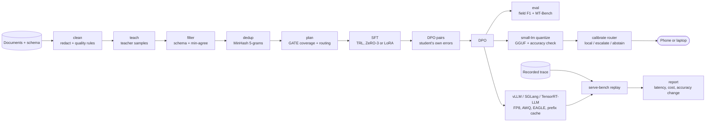

# hana-models

[](https://github.com/hanaml-lab/hana-models/actions/workflows/ci.yml)
[](LICENSE)

The lab's model factory, a system repo: post-train a small open model on one task, run it on the device or behind
a server, and measure what each serving choice costs in latency, money and accuracy. Documents are cleaned before a
frontier teacher sees them; teacher outputs are kept only where they validate and agree field by field; a student is
fine-tuned, then preference-tuned on its own errors; GATE's coverage rule picks the student size and routes each
prompt to the teacher or the verifier signal; the result is quantised for a phone with a calibrated router, or
served and replayed against recorded traffic. Each step is a package, and each hands its outputs to the next.

| Component | Language | What it does |
| --- | --- | --- |
| [`distill-kit`](packages/distill-kit) | Python | Personal-data redaction and quality rules, teacher sampling, schema repair and validation, a field-agreement filter, MinHash dedup, SFT and DPO recipes (TRL; ZeRO-3 or LoRA), DPO pairs from the student's own errors, field-level F1, and GATE planning. |
| [`small-lm`](packages/small-lm) | Python, Kotlin, C++ | GGUF quantisation with an accuracy check, an on-device SQLite retrieval index, and a calibrated router that answers locally, escalates or abstains; an Android app and a llama.cpp JNI bridge. |
| [`serve-bench`](packages/serve-bench) | Rust, Python | Replays recorded traffic against vLLM, SGLang or TensorRT-LLM; time to first token, inter-token and end-to-end latency per prompt-length bucket; cost per million tokens at a latency target; accuracy change per configuration. |
| [`hana-models`](packages/hana-models) | Python | The pipeline that wires the three together, with offline stand-ins for the teacher, the student and the server. |

## Install

Python 3.10 or later with [uv](https://docs.astral.sh/uv/), and a stable Rust toolchain for serve-bench's replayer.

```bash
git clone https://github.com/hanaml-lab/hana-models && cd hana-models
uv sync                                                          # the four Python packages
cargo build --release --manifest-path packages/serve-bench/Cargo.toml
uv pip install "./packages/distill-kit[train]"                   # TRL, PEFT, DeepSpeed: only for training on GPUs
```

The Android app needs JDK 21 and an Android SDK (platform 36); the llama.cpp bridge needs CMake 3.22 or later.

## Quickstart

```bash
make example        # builds serve-bench, then runs examples/end_to_end.py
```

The example runs the whole factory offline on 41 sample insurance claim forms. Recorded teacher samples stand in for
the frontier teacher, a rule-based extractor (`hana_models.student`) for the trained student, and two simulated
streaming servers (`hana_models.simserver`) for vLLM; serve-bench's Rust replayer runs for real against them.

```text
clean:  41 of 41 documents pass the quality rules; 0 personal-data spans redacted
distil: 41 documents -> 37 after filtering (8 teacher samples failed the schema) -> 36 after dedup
        15 DPO pairs from the student's mistakes; student held-out F1 0.8929
plan:   coverage of the stand-in student rho_1 = 0.58 (GATE needs >= 0.952; no candidate clears it)
        routes: 42% teacher, 0% verifier, 58% replay, 0% drop
route:  student fully right on 58% of documents; at 80% coverage the router keeps the ones it is right on 73% of the time
```

Each step is also a command. With real documents and a teacher behind an OpenAI-compatible endpoint:

```bash
cd packages/distill-kit
distill-kit clean --docs data/claims/ --out data/clean/          # redact, then apply the quality rules
distill-kit teach --docs data/clean/ --schema schemas/claim.json --teacher api:frontier --out traces.jsonl
distill-kit filter traces.jsonl --schema schemas/claim.json --min-agree 2 --out clean.jsonl
distill-kit dedup clean.jsonl --minhash --threshold 0.8 --out train.jsonl
distill-kit plan outcomes.jsonl --out routes.jsonl                # GATE: student size and per-prompt signal
bash scripts/train.sh recipes/sft-qwen3-8b.yaml                  # or recipes/sft-llama3.2-3b-lora.yaml
```

Each package README gives the commands for real models and GPUs.

## Architecture



How the pieces connect:

- `distill-kit clean` writes the folder `teach` reads, so no document reaches the teacher before personal data is
  redacted (`[EMAIL]`, `[PHONE]`, `[CARD]`, `[IBAN]`, `[NI_NUMBER]`) and it has passed the quality rules.
- `distill_kit.plan` takes verifier outcomes for the teacher and for each candidate student. The teacher-conditional
  coverage rho_k picks the smallest student that clears GATE's threshold of 0.952, and each prompt gets GATE's weight
  lambda(x) and a signal: teacher, verifier, replay or drop. The GATE trainer itself is the paper repo,
  [domain-distillation-rl](https://github.com/hanaml-lab/domain-distillation-rl).
- distill-kit's field-level F1 (`distill_kit.eval`) decides which student answers count as right; those labels train
  small-lm's router, so the router learns where the distilled student can be trusted on the device.
- The same student, served, is what serve-bench replays traffic against; `serve-bench accuracy` runs the task suite
  on each configuration in `packages/serve-bench/configs`, so a cheaper setting that loses accuracy shows both.
  `serve-bench report` reads the replay's `summary.json` and `requests.jsonl` and the accuracy step's `accuracy.json`
  from the same run folder.

## Results

### Reproduced by this repo

`make example` prints the numbers in the Quickstart above. They describe the offline example, not a model: the
student is a rule-based stand-in whose one sample per document solves it always or never, so the plan routes no
prompt to the verifier, and its coverage of 0.58 is the share of documents it gets fully right. The example also
replays the sample RAG trace against the two simulated servers; on an unloaded machine the FP8 profile with EAGLE
and a prefix cache gives the lower p95 time to first token and the lower cost per million output tokens. The
absolute figures depend on the machine, and on a heavily loaded one so can the order.

### Reported for the project

From the research project [A factory for small domain models](https://hanaml.com/research/model-factory):

| Metric | Baseline | Ours | Note |
| --- | --- | --- | --- |
| Extraction F1, insurance claims (held-out) | 0.72 | 0.86 | Qwen3-8B base, prompted vs. SFT+DPO |
| Routing accuracy (local vs. escalate), internal suite | 71% | 86% | Length heuristic vs. calibrated router |
| Cost per 1M output tokens | $2.10 | $0.84 | On-demand H100 pricing; same traffic replay |
| Same task, frontier teacher | 0.89 | 0.86 | Teacher is a frontier API model; student is 8B |
| MT-Bench (general ability kept) | 8.1 | 7.9 | Small regression after domain training |
| Cost per 1k documents | $14.20 | $0.90 | Teacher API vs. student on one L40S |
| Win rate vs. SFT-only (pairwise judge) | 50% | 64% | DPO on 12k preference pairs |
| Selective accuracy at 80% coverage | 74% | 88% | Qwen3-1.7B Q4_K_M; abstains on the hardest 20% |
| Decode speed, Pixel 8 (tokens/s) | 9.8 | 17.5 | FP16 vs. 4-bit, same model, sustained |
| Energy per completed task | 41 J | 19 J | Includes retrieval; measured with a USB power meter |
| Output tokens/s per GPU, Llama 3.1 70B | 1,050 | 2,480 | BF16 vLLM vs. FP8 + EAGLE-2 + prefix caching; 8xH100 |
| p95 time to first token, RAG workload | 1.9 s | 0.6 s | Shared system prompt and documents reused from KV cache |
| Accuracy change, internal task suite | 0.0 pts | -0.4 pts | FP8 weights and activations; within run-to-run noise |
| AWQ INT4 accuracy change | 0.0 pts | -1.8 pts | Larger drop on numeric extraction tasks |

## Papers

The project's papers, in order; the later one builds on the earlier one, whose SFT on filtered teacher traces is one
of GATE's baselines.

| Date | Paper | What this repo implements | PDF | Paper repo |
| --- | --- | --- | --- | --- |
| 2025-10-21 | [Distilling a frontier model into an 8B domain specialist](https://hanaml.com/research/papers/distilling-domain-agents) | `distill-kit`: teacher sampling, the field-agreement filter, MinHash dedup, SFT, DPO on the student's own errors, field-level F1 | [PDF](https://hanaml.com/papers/distilling-domain-agents.pdf) | [distilling-domain-agents](https://github.com/hanaml-lab/distilling-domain-agents) |
| 2026-02-24 | [GATE: Gap-Adaptive Mixing of On-Policy Distillation and Verifiable Rewards for Small Domain Specialists](https://hanaml.com/research/papers/domain-distillation-rl) | `distill_kit.plan`: the coverage rule rho_k >= 0.952 for the student size, and the per-prompt weight lambda(x) and routing | [PDF](https://hanaml.com/papers/domain-distillation-rl.pdf) | [domain-distillation-rl](https://github.com/hanaml-lab/domain-distillation-rl) |

## Models

Built with this factory:

- [clause-extract-8b](https://hanaml.com/models/clause-extract-8b): clauses and fields from contracts and claims as
  JSON; Qwen3-8B, SFT, DPO and distillation; Apache-2.0.
- [ondevice-summarise-1b](https://hanaml.com/models/ondevice-summarise-1b): summaries of notes and messages on a phone
  or a laptop; Gemma 3 1B IT, trained with quantisation in the loop; Gemma Terms of Use.

## Development

```bash
make test            # Rust tests, each Python package's tests, and the integration test
make lint            # ruff, rustfmt and clippy
make example         # the factory end to end, offline
make test-android    # the Kotlin router's unit tests (needs an Android SDK)
```

CI runs lint, the tests, the example and a CITATION.cff check on every push to `main` and every pull request, with
two more jobs: the Android unit tests on the runner's Android SDK, and a host build of the llama.cpp JNI bridge.

## Contributing

See [CONTRIBUTING.md](CONTRIBUTING.md). Security issues go to the
[security policy](https://github.com/hanaml-lab/.github/blob/main/SECURITY.md), not to a public issue.

## Citation

If you use this software, cite it as below; [CITATION.cff](CITATION.cff) has the same record.

```bibtex
@software{hanaml_hana_models_2026,
  author  = {{hanaML}},
  title   = {hana-models: a factory for small domain models},
  year    = {2026},
  version = {0.6.0},
  url     = {https://github.com/hanaml-lab/hana-models}
}
```

If you use the distillation pipeline or the GATE plan, cite the paper as well:

```bibtex
@techreport{agarwal2025distilling,
  author      = {Agarwal, Manav},
  title       = {Distilling a frontier model into an 8B domain specialist},
  institution = {hanaML},
  type        = {Technical report},
  year        = {2025},
  url         = {https://hanaml.com/research/papers/distilling-domain-agents}
}

@techreport{agarwal2026gate,
  author      = {Agarwal, Manav},
  title       = {{GATE}: Gap-Adaptive Mixing of On-Policy Distillation and Verifiable Rewards for Small Domain Specialists},
  institution = {hanaML},
  type        = {Technical report},
  year        = {2026},
  url         = {https://hanaml.com/research/papers/domain-distillation-rl}
}
```

## Licence

Apache-2.0. See [LICENSE](LICENSE). Trained models inherit the licences of their base models.
