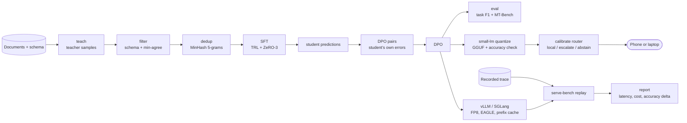

# hana-models

The lab's model factory: post-train a small open model on one task, run it on the device or behind a server, and
measure what each serving choice costs in latency, money and accuracy. Each step is a package; the packages hand
their outputs to each other.

| Component | Language | What it does |
| --- | --- | --- |
| [`distill-kit`](packages/distill-kit) | Python | Teacher traces, schema filtering with field agreement, MinHash dedup, SFT and DPO recipes (TRL, DeepSpeed), task and general-ability eval. |
| [`small-lm`](packages/small-lm) | Python, Kotlin, C++ | GGUF quantisation with an accuracy check, an on-device SQLite retrieval index, and a calibrated router that answers locally, escalates or abstains; Android app and llama.cpp JNI bridge. |
| [`serve-bench`](packages/serve-bench) | Rust, Python | Replays recorded traffic against vLLM, SGLang or TensorRT-LLM; TTFT, inter-token and end-to-end latency per prompt-length bucket; cost per million tokens at a latency target; accuracy delta per configuration. |
| [`hana-models`](packages/hana-models) | Python | The pipeline that wires the three together, with offline stand-ins for the teacher, the student and the server. |

## Architecture



How the pieces connect:

- distill-kit's field-level F1 (`distill_kit.eval`) decides which student answers count as right; those labels train
  small-lm's router, so the router learns where the distilled student can be trusted on the device.
- The same student, served, is what serve-bench replays traffic against; `serve-bench accuracy` runs the task suite
  on each serving configuration so a cheaper setting that loses accuracy shows both.
- `serve-bench report` reads the Rust replay's `summary.json` and `requests.jsonl` and the Python accuracy step's
  `accuracy.json` from the same run folder.

## Quickstart

```bash
git clone https://github.com/hanaml-lab/hana-models && cd hana-models
uv sync
make example        # builds serve-bench, then runs examples/end_to_end.py
```

The example runs the whole factory offline on 41 sample insurance claim forms: recorded teacher samples are
filtered and deduplicated, a rule-based stand-in student's mistakes become DPO pairs, the small-lm router is
calibrated on where that student is right, and serve-bench replays the sample RAG trace against two simulated
servers. The stand-ins are there so the plumbing runs on a laptop; the numbers it prints describe the example only.
For real runs, each package README shows the commands with real models and GPUs.

## Development

```bash
make test            # Rust tests, each Python package, and the integration test
make test-android    # the Kotlin router's unit tests (needs an Android SDK)
make lint
```

## Related

- Research: [domain post-training](https://hanaml.com/research/domain-post-training),
  [small language models](https://hanaml.com/research/small-language-models),
  [inference efficiency](https://hanaml.com/research/inference-efficiency).
- Paper: [Distilling a frontier model into an 8B domain specialist](https://hanaml.com/research/papers/distilling-domain-agents).
- Models built here: [clause-extract-8b](https://hanaml.com/models/clause-extract-8b),
  [ondevice-summarise-1b](https://hanaml.com/models/ondevice-summarise-1b).

## Licence

Apache-2.0. See `LICENSE`. Trained models inherit the licences of their base models.
